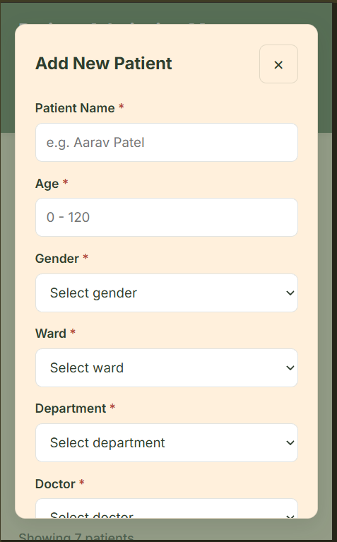
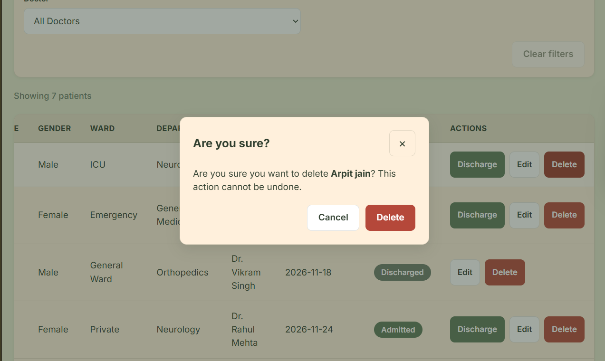

# Patient Admission Management App

A clean, production-ready hospital dashboard for managing patient admissions, ward assignments, discharges, and record updates.

## Live Demo

- **Frontend (Vercel):** `https://patient-admission-app-three.vercel.app`
- **Backend API (Render):** `https://patient-admission-app-l7o7.onrender.com likho.`

---

## Tech Stack

- **Frontend:** React.js (Vite + React, plain CSS with CSS variables)
- **Backend:** Python, FastAPI, Uvicorn
- **Database:** SQLite via SQLAlchemy (file-based `patients.db` locally; supports PostgreSQL via `DATABASE_URL` in production)
- **Validation:** Pydantic v2 on the backend + matching client-side rules in `src/utils/validators.js`

---

## Features

- **Add Patient:** Modal form with real-time and submit-time inline validation.
- **View Patients:** Responsive dashboard table on desktop/tablet and stacked cards on mobile.
- **Combinable Filters:** Filter simultaneously by **Ward**, **Department**, and **Doctor**, with a **Clear filters** button.
- **Case-Insensitive Search:** Search patients by partial name match alongside active filters.
- **Edit Patient:** Reuses the modal form pre-filled with the selected patient's details.
- **One-Click Discharge:** Instantly marks an admitted patient as `Discharged` (button hidden once discharged).
- **Delete with Confirmation:** Confirmation dialog (`"Are you sure?"`) with Cancel / Delete actions.
- **Feedback & States:** Loading spinner, `"No patients found"` empty state, and auto-dismissing success/error toast notifications.
- **Auto-Seeded Data:** Pre-populates 6 sample patients on first startup if the database is empty.

---

## Project Structure

```text
patient-admission-app/
├── README.md
├── .gitignore
├── backend/
│   ├── requirements.txt
│   ├── .env.example
│   ├── app/
│   │   ├── __init__.py
│   │   ├── main.py
│   │   ├── config.py
│   │   ├── database.py
│   │   ├── models.py
│   │   ├── schemas.py
│   │   ├── crud.py
│   │   ├── seed.py
│   │   └── routers/
│   │       ├── __init__.py
│   │       ├── patients.py
│   │       └── options.py
│   └── tests/
│       └── test_patients.py
└── frontend/
    ├── package.json
    ├── vite.config.js
    ├── index.html
    ├── .env.example
    ├── public/
    └── src/
        ├── main.jsx
        ├── App.jsx
        ├── api/
        │   └── patientsApi.js
        ├── components/
        │   ├── Header.jsx
        │   ├── FilterBar.jsx
        │   ├── PatientTable.jsx
        │   ├── PatientCard.jsx
        │   ├── PatientForm.jsx
        │   ├── Modal.jsx
        │   ├── ConfirmDialog.jsx
        │   ├── StatusBadge.jsx
        │   ├── Toast.jsx
        │   └── EmptyState.jsx
        ├── utils/
        │   └── validators.js
        └── styles/
            ├── variables.css
            └── global.css
```

---

## Environment Variables

### Backend (`backend/.env`)

Copy `backend/.env.example` to `backend/.env`:

| Variable | Example Value | Description |
| --- | --- | --- |
| `DATABASE_URL` | `sqlite:///./patients.db` | SQLAlchemy connection string (SQLite locally or PostgreSQL in production) |
| `FRONTEND_ORIGIN` | `http://localhost:5173` | Allowed CORS origin(s), comma-separated for multiple origins |

### Frontend (`frontend/.env`)

Copy `frontend/.env.example` to `frontend/.env`:

| Variable | Example Value | Description |
| --- | --- | --- |
| `VITE_API_URL` | `http://localhost:8000` | Base URL of the FastAPI backend |

---

## Run Locally

### 1. Start the Backend (FastAPI)

```bash
cd patient-admission-app/backend
python -m venv venv

# Windows (PowerShell)
.\venv\Scripts\Activate.ps1
# macOS / Linux
# source venv/bin/activate

pip install -r requirements.txt
copy .env.example .env   # On macOS/Linux: cp .env.example .env
uvicorn app.main:app --reload --port 8000
```

The API will run at `http://localhost:8000` (interactive docs at `http://localhost:8000/docs`).

Run backend tests:

```bash
pytest -v
```

### 2. Start the Frontend (React + Vite)

Open a new terminal:

```bash
cd patient-admission-app/frontend
npm install
copy .env.example .env   # On macOS/Linux: cp .env.example .env
npm run dev
```

The frontend will run at `http://localhost:5173`.

---

## API Endpoints

| Method | Endpoint | Description | Success / Error Codes |
| --- | --- | --- | --- |
| `GET` | `/api/options` | Returns allowed genders, wards, departments, doctors, and statuses | `200 OK` |
| `GET` | `/api/patients` | Lists patients with optional `search`, `ward`, `department`, `doctor` query params | `200 OK` |
| `GET` | `/api/patients/{id}` | Fetches a single patient record by ID | `200 OK`, `404 Not Found` |
| `POST` | `/api/patients` | Creates a new patient admission record | `201 Created`, `422 Validation Error` |
| `PUT` | `/api/patients/{id}` | Updates all fields of an existing patient | `200 OK`, `404 Not Found`, `422 Validation Error` |
| `PATCH` | `/api/patients/{id}/discharge` | Marks a patient's status as `Discharged` | `200 OK`, `404 Not Found` |
| `DELETE` | `/api/patients/{id}` | Permanently deletes a patient record | `200 OK`, `404 Not Found` |
| `GET` | `/health` | Health check endpoint | `200 OK` |

---

## Deployment Guide

### Backend on Render

1. Push the repository to GitHub.
2. Create a **New Web Service** on [Render](https://render.com/) pointing to the repo with:
   - **Root Directory:** `backend`
   - **Build Command:** `pip install -r requirements.txt` (if using PostgreSQL on Neon/Supabase, also add `psycopg2-binary` to `requirements.txt`)
   - **Start Command:** `uvicorn app.main:app --host 0.0.0.0 --port $PORT`
3. Configure persistence so data survives restarts (choose one):
   - **Option A (Render Persistent Disk):** Attach a disk mounted at `/var/data` and set `DATABASE_URL=sqlite:////var/data/patients.db`.
   - **Option B (Hosted PostgreSQL - Neon/Supabase):** Create a PostgreSQL database and set `DATABASE_URL` to your Postgres connection string.
4. Add `FRONTEND_ORIGIN` set to your deployed Vercel/Netlify URL (e.g., `https://your-app.vercel.app`).

### Frontend on Vercel (or Netlify)

1. Import the same GitHub repository on [Vercel](https://vercel.com/) or [Netlify](https://www.netlify.com/).
2. Set the **Root Directory** to `frontend`.
3. Build settings:
   - **Build Command:** `npm run build`
   - **Output Directory:** `dist`
4. Add environment variable `VITE_API_URL` set to your Render backend URL (e.g., `https://your-api.onrender.com`).
5. Deploy, then copy the live frontend URL back into `FRONTEND_ORIGIN` on Render.

---

## Screenshots




